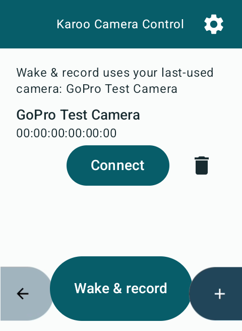
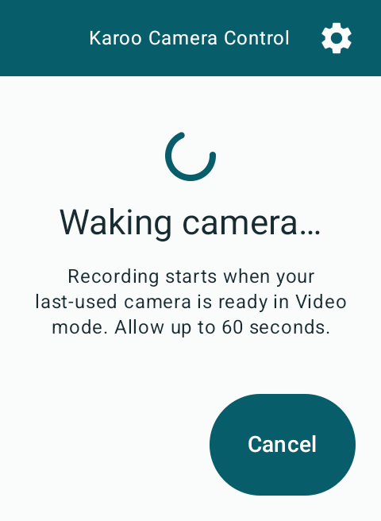
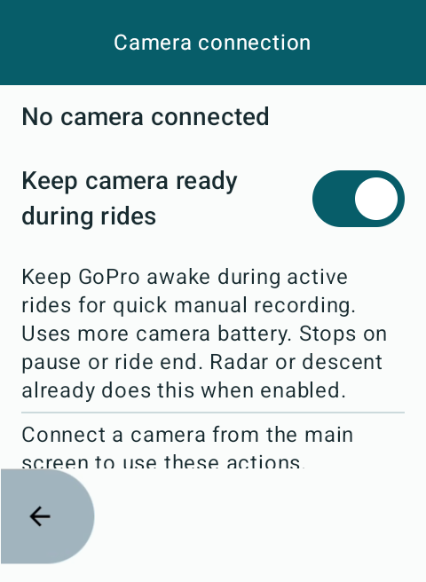

# Camera wake-up and ride keep-alive

## Manual recording

Opening the app shows saved cameras without automatically connecting. Use
**Connect** for normal camera controls, or **Wake & record** to connect to the
last-used saved camera and record with one press. The ride-screen recording
field also offers **Wake & record** while disconnected. First pairing remains
an explicit setup step; the app does not select an arbitrary newly discovered
camera or change mode/preset automatically.

The shared command controller shows **Waking camera…**, probes an existing
connection or makes a direct BLE connection, and waits for camera readiness and
known recording state/mode. If already recording, that clip is preserved. Otherwise
Video mode is required before sending shutter. **Starting…** then means shutter
has been requested; confirmed recording still requires acknowledgement and
camera status. A request is bounded to 60 seconds, including waiting for an
already-running readiness request. Failures expose an explicit retry, and never
queue a later Start through indefinite reconnects.

Cancel during wake-up sends no shutter. Once shutter has been sent, Stop uses
the existing acknowledgement/state-confirmation flow. Explicit Disconnect,
Forget of the selected camera, camera replacement, and extension shutdown
invalidate pending wake intent. Shutdown attempts Stop cleanup for an in-flight
Start but leaves a previously completed recording running. Cleanup can fail
if the camera/link becomes unavailable; check the camera in that case.

Manual Record can join a connection already being established for a saved
camera. If the ride then pauses or the readiness policy is disabled, the manual
request retains that connection attempt. Cancel invalidates the manual Start;
an independently requested Connect can still finish without starting a clip.

## Active-ride readiness

The extension enables one shared **3-second** BLE keep-alive loop when Karoo
reports an active ride (`RideState.Recording`) and either:

- radar recording is enabled;
- descent recording is enabled; or
- **Keep camera ready during rides** is enabled.

The last option is saved, **off by default**, and available under
**Settings & features → Camera connection**, including while disconnected.
It provides immediate manual readiness during active rides when both automations
are off. It does not start or stop a recording and is separate from whole-ride
recording. Automation settings alone do not keep a camera awake outside a ride.

Pause (including auto-pause), ride end, Karoo/ride stream loss, BLE disconnection
and service shutdown stop keep-alive. Resuming an eligible active ride restores
readiness, waking/reconnecting a saved camera if needed. Failed readiness attempts
are bounded to 60 seconds and retried after five seconds while still eligible.
Subscription completion/failure clears ride readiness and retries after three
seconds. Closing configuration does not stop the extension's ride monitoring.

An explicit Disconnect suppresses background reconnect until readiness is newly
enabled (for example after pause/resume or a policy change), or the rider explicitly
connects/records. Outside active-ride readiness, the app does not reconnect in a
background loop. Manual wake-and-record remains available outside rides.

Stopping keep-alive lets the camera's own sleep timers apply; it does not send
Sleep, Stop a manual clip, or change saved Auto Power Down. Keeping the GoPro
awake uses battery, including between clips. Battery savings from this policy
have not yet been measured on either device.

## BLE behavior and limits

The write uses Open GoPro Setting **0x5B**, value **0x42**, and waits for its
Settings Response. It defers behind a busy camera command and shares the BLE
operation mutex. Queued writes validate the original GATT identity. Normal
response time does not shift cadence; long busy periods never cause catch-up
bursts. Failures are logged and retried; cancellation is not reported as a camera
failure. Radar retains its existing shared keep-alive failure warning.

[Open GoPro recommends a three-second keep-alive](https://gopro.github.io/OpenGoPro/docs/ble/control/#keep-alive).
This supersedes issue #57's initial 60-second, connection-wide design following
the maintainer's battery/readiness decision. No dependency versions were changed.

[Connecting over BLE wakes a sleeping camera](https://gopro.github.io/OpenGoPro/docs/ble/protocol/ble_setup/#advertisements)
while it is advertising; GoPro documents the first eight hours after sleep.
Wake-up adds connection/boot delay and cannot guarantee instant recording or
wake a camera that is no longer advertising. Turn it on manually in that case.

## Validation

JVM tests cover cadence, timeouts, cancellation, readiness serialization and
manual retention of a background attempt across pause, manual recording state
transitions, wrong mode, existing clips, service shutdown cleanup, field actions,
and the ride/automation/fallback policy. The isolated Karoo emulator exercises
production wake UI/cancellation, no startup connection, offline fallback setting
persistence/recreation, navigation and RemoteViews. Sample camera states are
injected in test code, with no physical GATT connection.

```sh
./gradlew :app:ktlintCheck :app:testDebugUnitTest :app:verifyDescentRecording \
  :app:assembleDebug :app:lintDebug :app:assembleDebugAndroidTest
```

Physical Karoo/GoPro validation remains pending. Record models, firmware, app
build, auto-power-off preference, idle duration, wake-to-ready and wake-to-record
times, and battery consumption for both devices. Test app/field manual Start,
cancellation before and after shutter, camera replacement and wrong mode,
already-running clips, radar-only/descent-only readiness, both automations off,
fallback off/on, pause/resume/end, link/system/stream loss, explicit Disconnect,
and service shutdown/restart. Verify saved auto-power-off remains unchanged and
existing recording ownership/manual override behavior survives these transitions.




