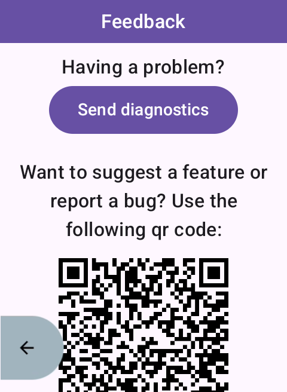
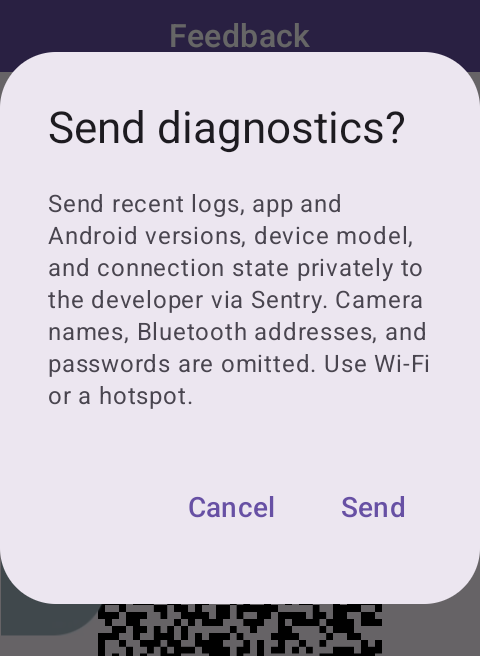
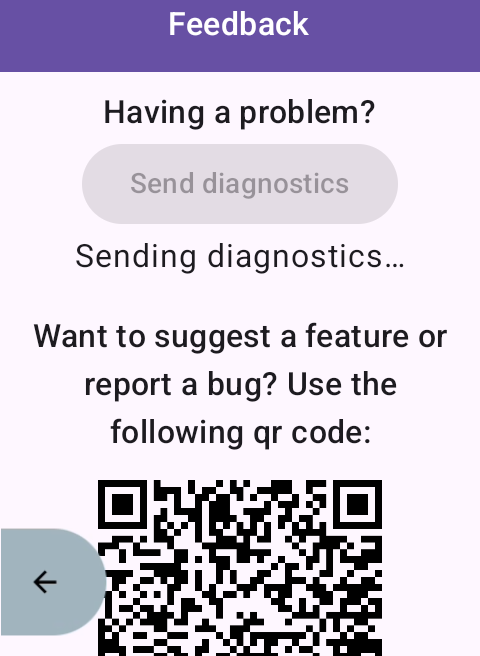
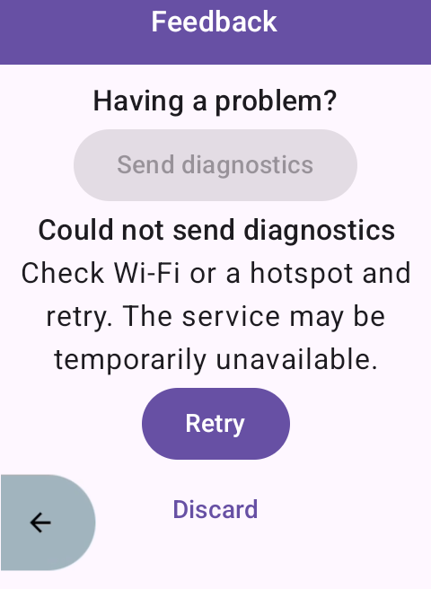
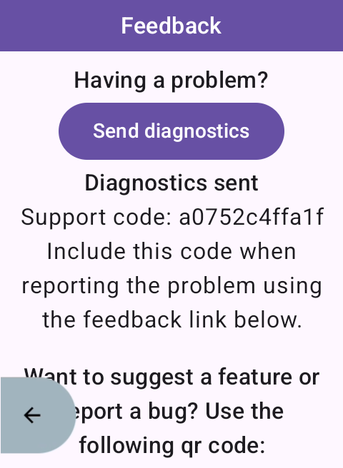
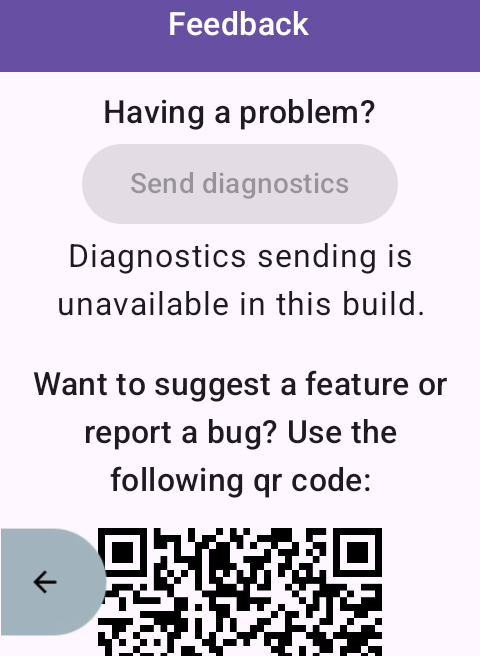

# Diagnostic reports

## Sending a report

Open the app menu and select **Leave Feedback** (the screen with feedback and tip QR
codes). Tap **Send diagnostics**, review the explanation, and tap **Send**.
Connect the Karoo to Wi-Fi or a hotspot first; uploads do not use the companion
Bluetooth relay. You do not need an account, ADB, or a file manager.

After **Diagnostics sent**, include the displayed support code when describing
the problem through the feedback QR or a GitHub issue. Sending diagnostics does
not create an issue or describe the problem for you. Reports and attachments are
private to the maintainer's Sentry project.

If uploading fails, the app keeps that snapshot for **Retry** or **Discard**.
Retries send the original snapshot with the same report identifier. Reports
expire after 24 hours, including across app restarts. Nothing is uploaded in the
background; reopening the app or reconnecting to a network never sends a report.

## Recorded data and limits

The app records permission outcomes, Bluetooth scanning, connection and pairing
transitions, command identifiers, response statuses, retries, timeouts, and
failures. Recording requests include command acknowledgements and confirmed
camera states. Entries contain timestamps and a per-process session identifier.

Camera names, Bluetooth addresses, passwords, notification contents, and raw BLE
payloads are omitted before writing. Exception diagnostics retain exception
classes and stack frames, not exception messages. No system logcat is read.
Reports include app version, device model, Android version, and connection state;
there is no persistent user or device identifier.

Four rotating files are limited to 256 KiB each (1 MiB total). Entries older than
seven days are pruned on recording maintenance and before snapshots. The most
recent complete log lines, up to 256 KiB, are attached. The asynchronous write
queue is bounded; under heavy load it can drop entries rather than block camera
control. Storage failures do not interrupt camera control.

Logs and the single pending report use private `noBackupFilesDir/diagnostics`
storage, excluded from Android backup and device transfer. Pending snapshots
are separate from the 1 MiB log limit. Successful submission, discard, or expiry
removes the pending snapshot. Uninstalling the app removes local diagnostics.

## Maintainer setup

1. Create a hosted Sentry project on the free Developer plan. Do not enable paid
   overages; an OSS sponsorship is optional. Configure project attachment access
   for the maintainer and disable server-side storage of client IP addresses.
2. Set the GitHub repository Actions variable **SENTRY_DSN** to the project's
   public HTTPS DSN. This ingestion key is embedded in the APK; it is not a
   privileged API token. Never put a Sentry API/auth token into the app.
3. For local builds, set the `SENTRY_DSN` environment variable before invoking
   Gradle. Builds without it compile and show sending as unavailable. Publishing
   builds fail when the repository variable is missing.
4. Search Sentry using `report_id:<support-code>` to locate the event and download
   `diagnostics.txt`. Release mappings are preserved in a build artifact named
   `obfuscation-mapping-<version>` and attached to releases as `mapping.txt`.

The pinned Sentry core SDK is used without global initialization or automatic
integrations. A dedicated synchronous HTTPS transport submits one event and one
attachment per explicit send/retry. It disables redirects, background retries,
SDK disk caching, automatic crashes, sessions, tracing, logs, and client reports.
Only a successful HTTP response without a quota header reports success; an event
ID alone is not proof of acceptance. Sentry ingestion acceptance does not
promise permanent storage or bypass server-side quotas or filtering. A lost
response can leave delivery uncertain; manual retries retain the same event ID.

## Release validation

Run the diagnostic unit tests, the Gradle build, and ktlint. Inspect the Feedback
screen in unavailable, confirmation, sending, failure/retry, and sent states at
Karoo resolution. Before shipping, verify a signed release on a real Karoo over
Wi-Fi/hotspot, find its event and log attachment in Sentry, and exercise camera
pairing and recording while sending. Check ordinary usage produces no Sentry
requests. Companion-only connectivity is outside this feature's supported path.

## Screenshots

Karoo-resolution emulator captures of the production Feedback composables. The
ready, confirmation, and sent screens were captured through the real app flow;
sending, failure, and unavailable states use sample state injection. No fixture
activity or screenshot-only app configuration is included in production.

