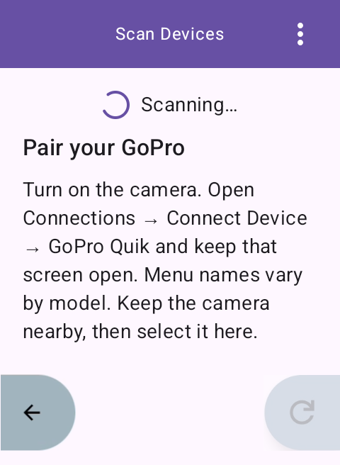
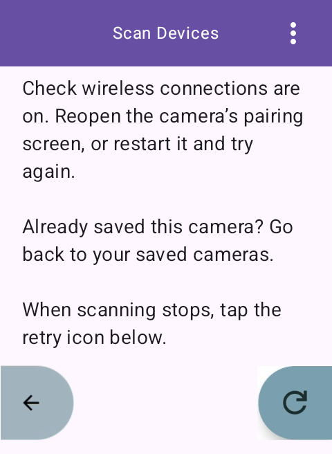

# Karoo 3 GoPro pairing notification flow

## Purpose

Karoo 3 may require Android Settings to confirm a GoPro's Bluetooth "Just
Works" pairing request. Karoo Camera Control uses an Android
`NotificationListenerService` only after the device owner explicitly grants
notification access.

## First pairing

### Camera discovery

The scan screen immediately asks the user to turn on their GoPro and enter
pairing mode via **Connections → Connect Device → GoPro Quik**. Menu names vary
by camera model. This selects the camera's pairing mode; using the Quik phone
app is not required to connect to Karoo Camera Control.

After 30 seconds of scanning without a new camera, troubleshooting replaces the
initial instructions and suggests checking wireless connections, re-entering
pairing mode, or restarting the camera. The help remains visible after the
two-minute scan timeout; the retry icon starts another scan and resets the help
timer. Discovering a new camera hides the troubleshooting. Already saved
cameras are excluded from the new camera list, and the help directs the user
back to their saved cameras.

The screen shows camera results as soon as a new camera is found, replacing
the guidance. Content scrolls behind the fixed Back and Retry buttons. Bottom
content padding lets the final lines scroll above the buttons without reserving
an empty strip across the screen. No factory reset or automatic bond removal is
part of this recovery flow. An empty scan alone cannot identify a camera-side fault.

Reference: [Open GoPro BLE setup](https://gopro.github.io/OpenGoPro/docs/ble/protocol/ble_setup/).

### Karoo notification access

1. Before a first pairing, the scan screen explains that this is a one-time
   setup. Its **Open settings** button opens Android's
   notification-access settings and tells the user to turn on Karoo Camera
   Control, accept the system prompt, return to the app, and tap **Connect**.
2. The user enables notification access for Karoo Camera Control.
3. The app connects to the selected GoPro and reads its protected WAP-password
   characteristic, which starts Bluetooth pairing.
4. The listener finds the Android Settings Bluetooth notification and invokes
   only its uniquely identified **Pair & connect** action.
5. The app waits for `BOND_BONDED` before it enables GoPro response
   notifications or sends commands.

If notification access is absent, the app does not start pairing. It shows the
notification-access setup screen instead. If the expected Settings action is
not available, it fails with an actionable error and records the number of available
actions in diagnostic logs, without notification contents. It never calls privileged Bluetooth confirmation
APIs or sends an unrecognised notification action.

## Scope and validation

The Karoo-resolution emulator was used to check initial discovery guidance,
troubleshooting after 30 seconds, retention after the two-minute timeout, and
reset on Retry. The final instructions can scroll above the overlay buttons.
Emulator checks do not validate physical GoPro discovery or pairing behavior.

This is a Karoo 3-specific integration workaround. The Settings package,
Bluetooth notification channel, and action title must be verified on the
target firmware before release. A successful first-pairing test must show:

`ACTION_PAIRING_REQUEST` -> Settings pairing notification -> Pair & connect
action -> `BOND_BONDED` -> GoPro notifications and commands succeed.
