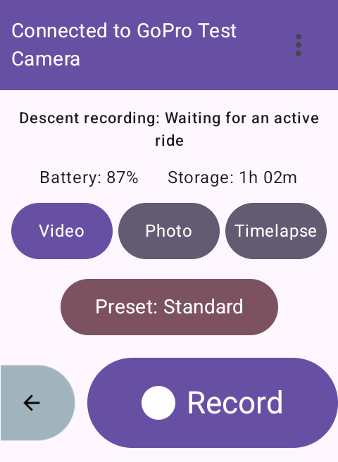
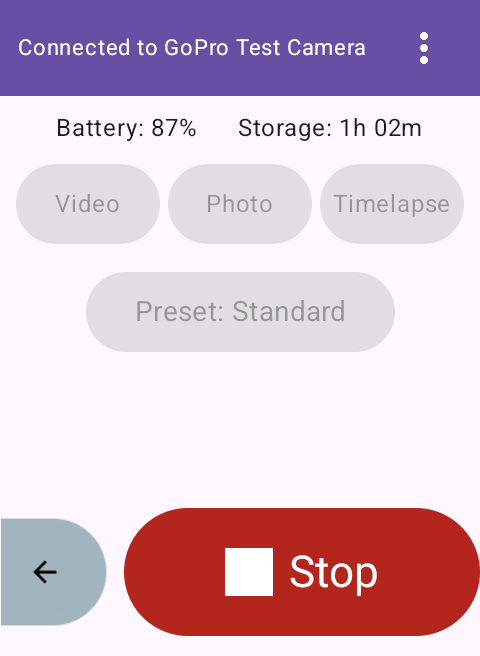
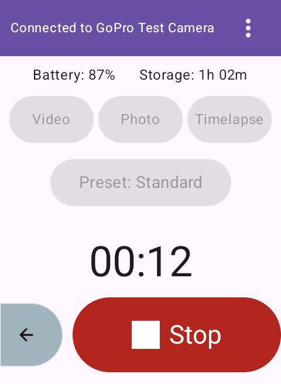

# Recording controls

The app confirms a recording start or stop in two stages: it first waits for
the GoPro Set Shutter (`0x01`) command response to report success, then
verifies the requested recording state from the GoPro status response or its
registered status update.

The record control remains available while a recording command is in flight.
A second press stops or cancels the pending recording request even before the
GoPro has reported that recording began. Mode and preset controls remain
disabled while recording because the GoPro cannot safely switch them
mid-recording.

Manual commands from the app and the [ride-screen recording field](ride-screen-recording-controls.md), and [automatic descent starts](descent-recording.md) use the
same application-scoped controller. Command progress remains visible when
the screen is reopened, and failures appear in a snackbar. Record/Stop and Back
share a fixed bottom row on the Karoo screen, with the recording timer above.
Other camera details scroll when needed, with a gap above the fixed controls.
Descent status appears in **More options → Descent recording**, keeping the
camera controls clear. Battery and storage share a compact row so the mode and preset controls fit
more comfortably. Tap the preset button, labelled with the current preset, to
choose another preset. The 48 dp app header keeps its title on one line. It measures the available
width and selects a text size from 12 down to 10 sp. Names that still do not
fit at 10 sp are ellipsized, preserving a readable minimum and the menu target. A manual Stop suppresses
automatic starts until the next descent.

If the shutter response or recording-state confirmation times out, the shared
controller reports **Camera command timed out** in the snackbar and releases
the controls for retry or manual Stop. Cancelling a command through manual
override or disconnection does not report a timeout error.

An optional **Stop at descent end** setting stops only clips started by descent
automation, after confirmed flatter terrain or ride finish. It is off by
default. Automatic stops use the same acknowledgement and progress path;
manual Stop remains available while an automatic stop is pending. Manual clips
and recordings found after reconnect are never stopped by this option.

Optional [radar-triggered recording](radar-recording.md) uses the same shared
command controller. Each automation stops only its own recordings. Manual
controls override radar for the current encounter.

Recording requests, command acknowledgements, confirmed states, and failures are
recorded in the local [diagnostic log](diagnostic-reports.md). Uploading that log
requires an explicit action in the Leave Feedback screen.

Optional [native camera alerts and sound](camera-alerts.md) confirm verified
recording transitions and warn about failed recording commands, connection
loss and low camera resources during active or paused rides. Preferences are
independent; in-app failures remain visible regardless of notification settings.

## Layout verification

The connected screen was checked on the isolated 480×800 Karoo emulator with
a sample camera and populated presets. The UI runner checks that the preset
button is fully visible both at rest and while recording, with a gap above
the fixed recording controls, and
that Stop stays available during pending commands and active recording. It
uses the production header and checks a single-line normal title and a long
title that ellipsizes at the 10 sp minimum.
Debug app/test APK builds, formatting checks, and Android lint passed, along
with 22 unit tests and all 41 deterministic descent-recording checks. Physical
Karoo/GoPro regression testing remains a release validation step.

