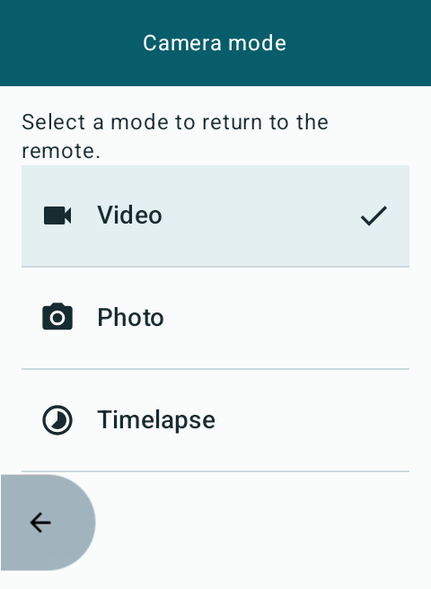
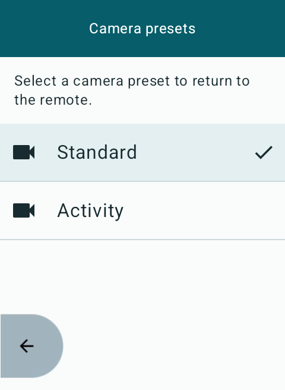

# Recording controls

The app confirms a recording start or stop in two stages: it first waits for
the GoPro Set Shutter (`0x01`) command response to report success, then
verifies the requested recording state from the GoPro status response or its
registered status update.

The record control remains available while a recording command is in flight.
A second press stops or cancels the pending recording request even before the
GoPro has reported that recording began. Mode and preset controls remain
disabled while recording because the GoPro cannot safely switch them
mid-recording.

Manual commands from the app and the [ride-screen recording field](ride-screen-recording-controls.md), and [automatic descent starts](descent-recording.md) use the
same application-scoped controller. Command progress remains visible when
the screen is reopened, and failures appear in a snackbar. Record/Stop and Back
share a fixed bottom row on the Karoo screen. Back retains the standard Karoo
artwork. Record/Stop keeps its 64 dp height and has a rounded left end and a
flat right edge flush with the display boundary.

## Glance remote

The app uses a light theme with teal controls. The connected header shows the
camera name; connection detail appears below the central status. **Camera
ready** leads while stopped, **Starting…** / **Stopping…** distinguish pending
commands, and the large timer appears only for confirmed recording. The timer
includes hours for clips over an hour. A command request never appears as a
successful recording. Unknown recording/mode data displays **Waiting for camera state**
and disables new starts and capture changes. Stop remains available throughout
pending operations.

**Mode** and **Preset** are separate 48 dp controls. Mode opens a dedicated
Video / Photo / Timelapse list. Selecting a mode uses the existing GoPro mode
command and returns to the remote without loading a preset. Selecting the
already active mode returns without sending a command. The camera determines
its active preset after a mode switch; the app does not invent or cache preset
choices. Preset opens only the presets reported by the camera for its current
mode. Selecting one returns to the remote. Both lists disable changes while
recording, while a command is pending, or after disconnection.

**Radar** and **Descent** have separate status rows below the capture controls.
Each shows its own Off, waiting, recording or blocked state from its existing
controller. Enabled does not imply ready. Radar's stop-delay text is the
configured delay, not a live countdown. A descent-owned recording is labelled
Recording; unowned recordings are not attributed to descent. Detailed settings
remain under **Settings & features → Automatic recording**. Long details can
scroll above the fixed bottom controls.

### Right hardware button

The foreground activity handles Android's `KEYCODE_NAVIGATE_IN` as Record/Stop
only on the connected remote. It uses the same manual recording controller as
touch. Settings, mode selection and preset selection retain normal key behavior.
Held/repeated keys, cancelled events, combinations, and presses that cross
screen or connection changes do not trigger recording. Leaving the activity
clears an outstanding press.

This verifies the Android input route, not the physical Karoo mapping. The
Karoo SDK describes the bottom-right D button as accept/navigate-in, but target
hardware and firmware must still be checked for the event actually delivered,
short/long presses and system combinations. No global ride-screen remapping or
Bonus Action is added, and no dependencies were updated. The existing
[ride-screen recording field](ride-screen-recording-controls.md) is unchanged.

References: [Android key handling](https://developer.android.com/develop/ui/views/touch-and-input/keyboard-input/commands),
[Karoo hardware-action descriptions](https://hammerheadnav.github.io/karoo-ext/karoo-ext/io.hammerhead.karooext.models/-perform-hardware-action/index.html).
A manual Stop suppresses automatic starts until the next descent.

If the shutter response or recording-state confirmation times out, the shared
controller reports **Camera command timed out** in the snackbar and releases
the controls for retry or manual Stop. Cancelling a command through manual
override or disconnection does not report a timeout error.

An optional **Stop at descent end** setting stops only clips started by descent
automation, after confirmed flatter terrain or ride finish. It is off by
default. Automatic stops use the same acknowledgement and progress path;
manual Stop remains available while an automatic stop is pending. Manual clips
and recordings found after reconnect are never stopped by this option.

Optional [radar-triggered recording](radar-recording.md) uses the same shared
command controller. Each automation stops only its own recordings. Manual
controls override radar for the current encounter.

Recording requests, command acknowledgements, confirmed states, and failures are
recorded in the local [diagnostic log](diagnostic-reports.md). Uploading that log
requires an explicit action in the Feedback & diagnostics screen.

Optional [native camera alerts and sound](camera-alerts.md) confirm verified
recording transitions and warn about failed recording commands, connection
loss and low camera resources during active or paused rides. Preferences are
independent; in-app failures remain visible regardless of notification settings.

## Layout verification

The connected-screen runner exercises the production composables on an isolated
480×800 Karoo AVD with sample camera state and camera-provided sample presets.
It checks pending and confirmed Start/Stop, manual overrides, mode/preset locks,
visible preset controls, direct return from both selection pages, long-title
ellipsizing, and synthetic Android NAVIGATE_IN presses including held-key
suppression. Settings navigation checks verify hardware-record handling is
removed in mode selection and settings. These checks do not establish physical
button delivery or real GoPro BLE behavior.

