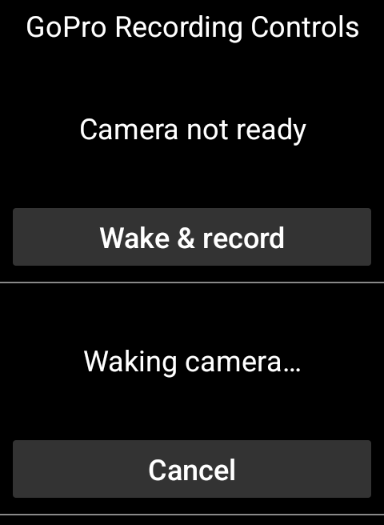

# Ride-screen recording controls

Add **GoPro Recording Controls** to a Karoo ride profile as a graphical data
field. Pair a camera in the app first, then return to the ride screen.
A saved, disconnected camera offers **Wake & record**; no separate Connect step
is required. [Wake-up and readiness](connection-keep-alive.md) explains latency,
cancellation and active-ride keep-alive.
The app activity can remain closed while the extension displays the field.
Existing GoPro Status, Rec Time, and Battery numeric fields are unchanged.

The field uses the pinned Karoo SDK's `DataTypeImpl.startView` and RemoteViews
API. It does not require a dependency update or a Bonus Action mapping.

## States and actions

| Camera/command state | Field | Action |
| --- | --- | --- |
| Connected, confirmed stopped, Video mode | Camera ready | Start recording |
| Start awaiting confirmation | Starting… | Stop / cancel |
| Confirmed recording | Recording and elapsed time | Stop recording |
| Stop awaiting confirmation | Stopping… | Wait; repeated taps are ignored |
| Command failed | Command failed with reason | Retry Start or Stop when confirmed camera state permits |
| Radar Start failed or remains unconfirmed | Command failed (or Starting… if the error was cleared) | Stop / cancel; Start is rejected until cleanup |
| Saved camera disconnected/connecting | Camera not ready | Wake & record |
| Wake request pending | Waking camera… | Cancel without sending shutter |
| No saved camera | Camera disconnected | Pair in the app first |
| Recording state or stopped camera mode unknown | Waiting for camera state | Unavailable |
| Stopped in another mode | Select Video on camera | Unavailable |
| Mode/preset command pending | Camera busy | Unavailable |

A command request is not shown as confirmed recording. Start/Stop use the same
acknowledgement and recording-state confirmation as the app. No mode or preset
is changed automatically. Manual actions release automation ownership and apply
the existing radar/descent overrides. Stop cancels a pending start before the
camera confirms recording. When [camera alerts](camera-alerts.md) are enabled,
field commands use the same native confirmations and failure alerts as app commands.
Physical shutter changes and reconnects are reflected
from the manager's live state.

Every action is explicitly Start or Stop and revalidated on the main thread
against current camera/command state. A stale Start cannot become Stop and a
repeated Stop cannot restart a pending stop.
After an ambiguous radar Start, the field offers Stop even if the last confirmed
camera state is stopped. A stale Start tap is rejected before releasing radar
ownership, so radar can still complete its cleanup Stop. Once cleanup succeeds,
Start becomes available again when the confirmed state and mode permit it.

Actions are delivered through an
explicit immutable PendingIntent to a non-exported receiver, without opening the
app activity. Removing the field cancels its rendering coroutine.

## Size, preview, and appearance

Use a field at least **160 × 112 dp**. Smaller fields display **Use a larger field**
and expose no camera action. Buttons are 48 dp high. The field uses white text on
black and a dark action button for consistent contrast; recording state is always
shown in words. Profile-edit previews demonstrate the ready layout with a disabled
button and no action PendingIntent.

Rendering samples current state once per second to respect the SDK's RemoteViews
rate limit. Display changes can lag by up to one second; tap validation uses live
state immediately.

## Verification and hardware limits

Unit tests cover state guards, failures, timer formatting, stale/repeated actions,
pending-start cancellation, ambiguous radar-start cleanup, and automation ownership. Emulator instrumentation
applies and reapplies the actual RemoteViews, checks preview/small-size guards,
checks that the receiver is private, and safely clicks an action while disconnected.
PR screenshots show production RemoteViews with synthetic camera states in a test
host, not the native Karoo ride screen.

Physical Karoo/GoPro QA is still required for native ride-screen touch forwarding,
field sizes and day/night readability on target firmware, real BLE start/cancel/stop
confirmation, camera-side changes, reconnection, and automation regression checks.
An emulator cannot verify those hardware paths.

The wake-state capture below uses sample values in the production RemoteViews
test host, not a native Karoo ride page or physical BLE connection.

