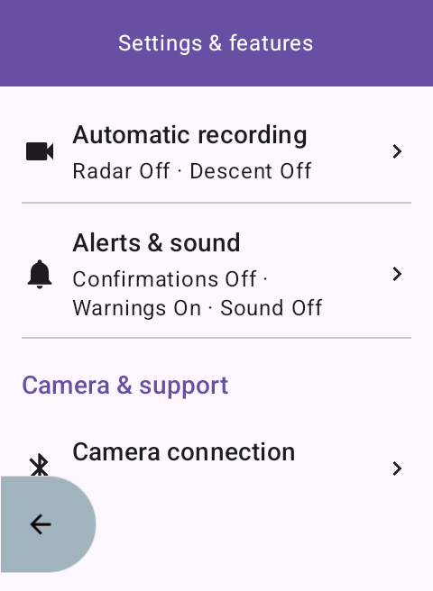
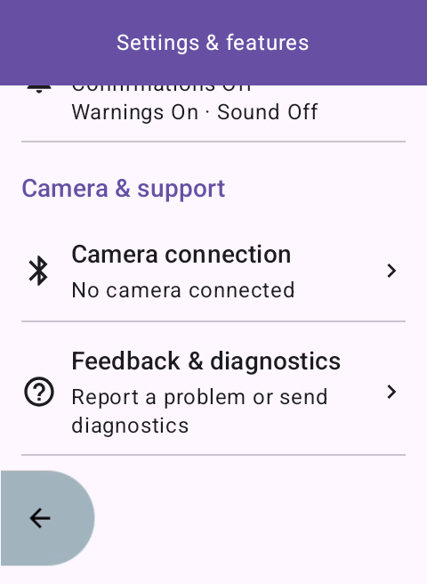
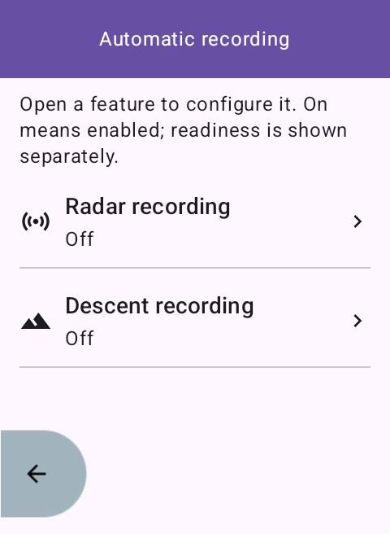
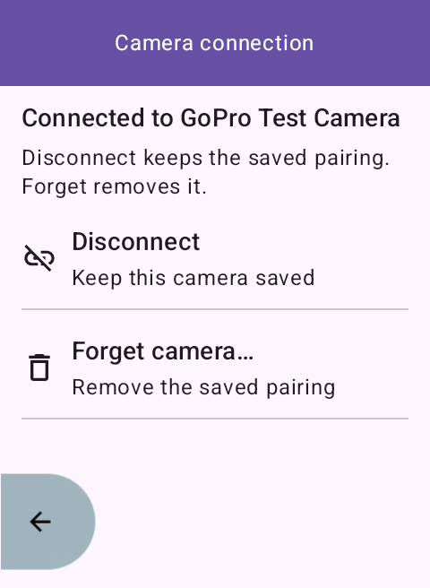
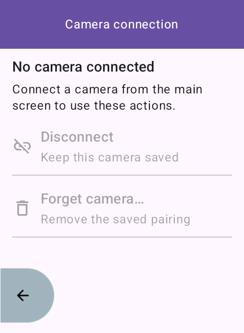

# Settings and features

Open the gear icon on the camera screen to configure the extension. The
full-screen **Settings & features** hub groups configuration separately from
the camera's mode, preset and Record/Stop controls.

## Pages

| Page | Contents |
| --- | --- |
| Automatic recording | [Radar recording](radar-recording.md) and [Descent recording](descent-recording.md), with separate saved On/Off choices and current status. |
| Alerts & sound | [Recording confirmations, camera warnings and sound](camera-alerts.md). |
| Camera connection | Current connection state, Disconnect and Forget camera. |
| Feedback & diagnostics | Feedback and tip QR codes, plus [explicit diagnostic uploads](diagnostic-reports.md). |

The hub's automation summary describes saved preferences. **On** does not mean
the feature is ready: open Automatic recording to see whether it is waiting
for a camera, Karoo, a ride or telemetry. Neither opening a row nor navigating
Back changes a preference. Changes inside a settings screen save immediately.

The hub scrolls; Camera & support appears below feature configuration. Large
rows open their settings pages without toggling them. Back remains fixed at
the bottom, outside the scrolling content.

## Back and connection behavior

Both on-screen Back and Android/hardware Back follow the same hierarchy.
Radar/descent settings return to Automatic recording, then to the hub. Alerts,
camera connection and feedback return directly to the hub. Lists remember
their scroll position when returning from a child page.

Back from the hub returns to the main view that opened it, including scanning.
Scanning and connection/pairing work continue while settings are open. If a
connection finishes, returning to the main screen shows the connected camera.
Unexpected connection loss updates status without closing settings, which
remain editable while offline.

Disconnect keeps the saved camera; Forget camera asks for confirmation and
removes its saved pairing. Both actions require a currently connected camera
and return to the main screen. Cancelling Forget leaves the connection intact.
A confirmation for an earlier connection cannot forget a replacement camera,
including one with the same display name. Manage other saved cameras from the
existing main-screen camera list.

Navigation survives activity recreation. A full process restart opens the
main screen, with saved preferences retained. Confirmation dialogs and camera
commands are not restored or replayed. Opening feedback never sends diagnostics
by itself; its explicit Send/Retry flow is unchanged.

## Scope

This change reorganizes existing configuration. Future features get entries
when they ship; the hub contains no empty categories or coming-soon rows.
The [navigation roadmap](roadmap/settings-and-features-navigation.md) records
where automatic HiLights, capture options and button guidance will belong.
Recording ownership, manual override, pairing, camera commands, existing
preference defaults and dependency versions are unchanged.

## Verification

Build and local checks:

```sh
./gradlew :app:ktlintCheck :app:testDebugUnitTest \
  :app:verifyDescentRecording :app:assembleDebug :app:lintDebug
```

The `ScreenNavigationTest` unit tests cover parent traversal, scanning origin,
connection completion inside settings, repeated entry taps and preset return.
The emulator-only `SettingsNavigationInstrumentation` exercises the production
activity, live preference summaries, activity recreation, disconnected actions,
connection replacement,
pending commands and recording, feedback navigation and scanning return. Its
sample camera states are injected in test code with no GATT connection; the
runner refuses physical devices and saved-camera app data.

```sh
./gradlew :app:assembleDebug :app:assembleDebugAndroidTest \
  -PcameraTestRunner=com.karoocameracontrol.SettingsNavigationInstrumentation
adb -s <isolated-emulator> shell am instrument -w \
  com.karoocameracontrol.test/com.karoocameracontrol.SettingsNavigationInstrumentation
python3 scripts/verify-camera-alert-settings.py <isolated-emulator>
python3 scripts/verify-descent-settings.py <isolated-emulator>
```

Install both APKs and grant Bluetooth/Location permissions before running.
The preference scripts check the new hierarchy, persistence and both Back
paths, restore defaults, and capture the changed screens. Existing descent
UI instrumentation checks pending and confirmed Stop with the new gear header.
Physical Karoo/GoPro regression validation remains required before release.

On 2026-10-17, the debug build, ktlint, Android lint (warnings, no errors),
all 58 JUnit tests and all 41 deterministic descent checks passed. The Karoo
480×800 emulator passed the production navigation runner and both preference
scripts, including activity recreation, live summaries, persistence, input
bounds and both Back paths. The connected-camera UI runner also passed pending
and active Stop, mode locks, preset visibility, manual override and long-title
checks with the gear header. Physical Karoo/GoPro validation remains pending.

## Screenshots

App-only captures from the isolated Karoo emulator. The connected page uses a
sample camera state without a physical BLE connection.






